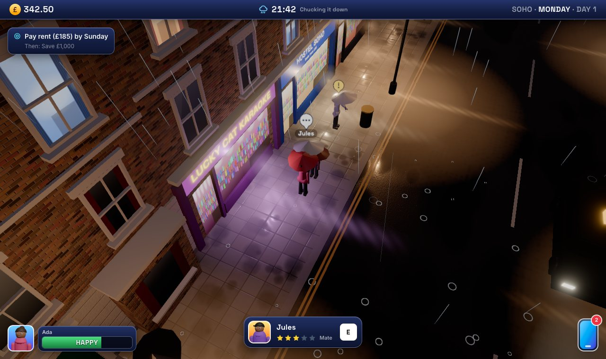
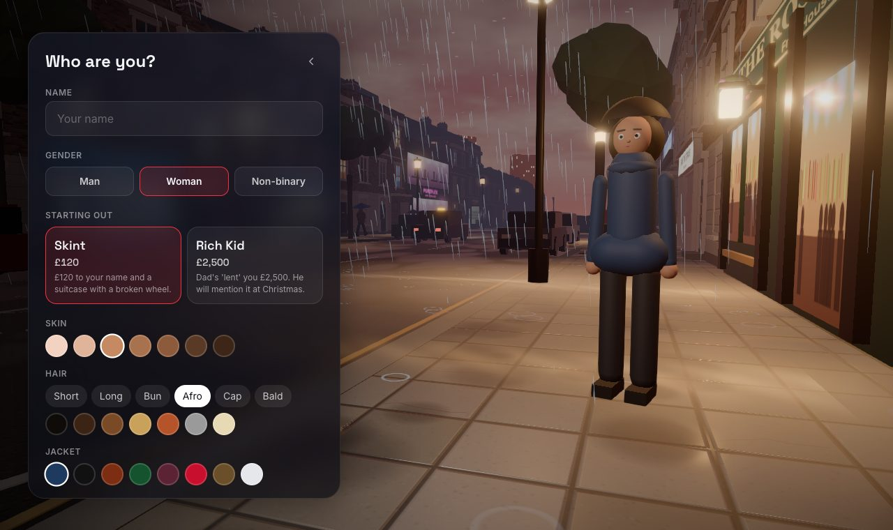
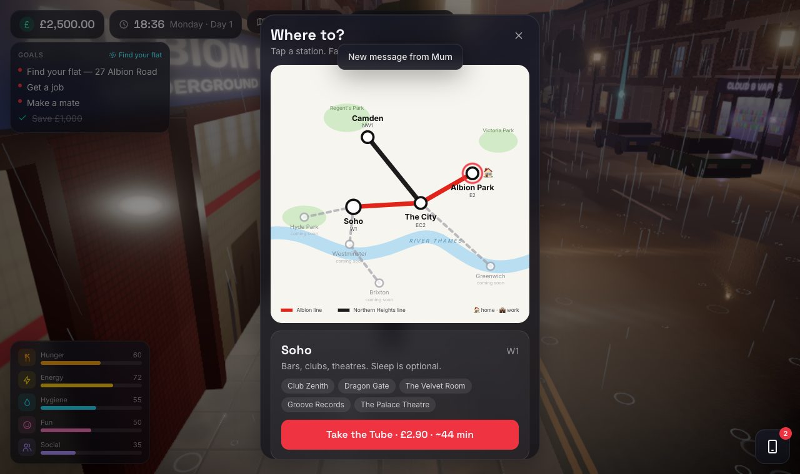

# UK Life

A free 3D life sim that runs in the browser, set in rainy London. You arrive with a suitcase and £185 a week rent to find: get a job, make some mates, ride the Tube between districts, and whatever you do, pay Kev the landlord on Sunday.



## Who it's for

People who like life sims such as The Sims, Gameloft's *Miami Nights* / *My Life in New York*, or the browser game *Lagos Life*, and want one that opens from a link on a phone or laptop, with no download.

## What you can do

- **Make a character:** name, gender (man, woman, non-binary), skin, hair, an outfit (casual, hoodie, suit, dress, hi-vis, punk and more) and its colours, with a live 3D preview.
- **Live on a London high street** in London's real weather. You arrive at the real time of day, and from then on the weather follows the actual London forecast hour by hour, with sunrise and sunset to match. Wet roads, street lamps, neon and traffic that drives on the left.
- **Look after your needs:** hunger, energy, hygiene, fun and social.
- **Work:** baristas, fryers, bar staff, delivery riders, waiters, club promoters, market traders and a City analyst job that needs a suit and experience. Wages use the UK National Living Wage (£12.71/hr from April 2026).
- **Pay rent** every week, or get evicted after two missed weeks.
- **Meet people:** 12 locals with their own personalities. Chat, banter, invite them for a pint, flirt.
- **Travel by Tube** between four districts on a Tube-style map: Albion Park (E2, home), the City (EC2), Soho (W1) and Camden (NW1). Fares, journey times and a night bus after 00:30.
- **Use your phone:** messages, jobs, banking, maps, contacts and settings.
- **Pick up where you left off:** your life saves automatically in your browser, and Continue on the title screen takes you back. Saves never leave your device.

| Character creator | Tube map |
|---|---|
|  |  |

## Built with

- [Three.js](https://threejs.org/) for the 3D world, with [postprocessing](https://github.com/pmndrs/postprocessing) for bloom and tone mapping
- [React](https://react.dev/) and [Tailwind CSS](https://tailwindcss.com/) for the interface
- [Zustand](https://github.com/pmndrs/zustand) for game state
- [Vite](https://vitejs.dev/) and TypeScript

Every texture (brick, slate, asphalt, signs, shop interiors) is drawn in code at start-up, and the vehicles and buildings are built from code. The fonts (Inter and Space Grotesk) load from Google Fonts.

Your character is a 3D model from Quaternius's [Ultimate Modular Men](https://quaternius.com/packs/ultimatemodularcharacters.html) and [Women](https://quaternius.com/packs/ultimatemodularwomen.html) packs (CC0). Only the outfits that suit London are used, without their weapons, and they're slimmed down by `scripts/build-people.mjs` into `public/people/` (about 2.5 MB for all 13 outfits). The hairstyles and umbrella are the game's own.

Weather and sunrise/sunset times come from [Open-Meteo](https://open-meteo.com/), which is free and needs no API key (data under CC BY 4.0). If it can't be reached, the game makes up its own weather.

## Run it locally

You need [Node.js](https://nodejs.org/) 20.19 or newer.

```bash
npm install
npm run dev
```

Then open http://localhost:5173.

To make a production build in `dist/`:

```bash
npm run build
```

## Controls

| | Keyboard and mouse | Touch |
|---|---|---|
| Walk | WASD or arrow keys (Shift to run), or click the ground | Thumbstick, or tap the ground |
| Look | Drag | Drag; pinch to zoom |
| Interact | E | Tap the prompt |
| Phone | P | Phone button |

## Project structure

```text
src/
  state/        game rules and data: needs, jobs, rent, places, people, districts
  game/         the 3D side: renderer and game loop
    world/      street builder, district looks, sky, rain, lighting, textures
    actors/     player, locals and pedestrians, traffic, camera
    systems/    input and audio
  ui/           title screen, HUD, phone, menus, Tube map
```

## Status

This is an early prototype. It's single-player, and it hasn't been tested on a real phone. See [ROADMAP.md](ROADMAP.md) for what's next and the known issues.

## How it was made

I started this on 9 October 2026, building it with an AI coding assistant (Claude Code). The code was first put in git on 3 November 2026, so the history starts there.

## Credits

Character models by [Quaternius](https://quaternius.com), CC0 ([licence](public/people/LICENSE.txt)). Weather data by [Open-Meteo](https://open-meteo.com/), CC BY 4.0.

## License

[MIT](LICENSE)
